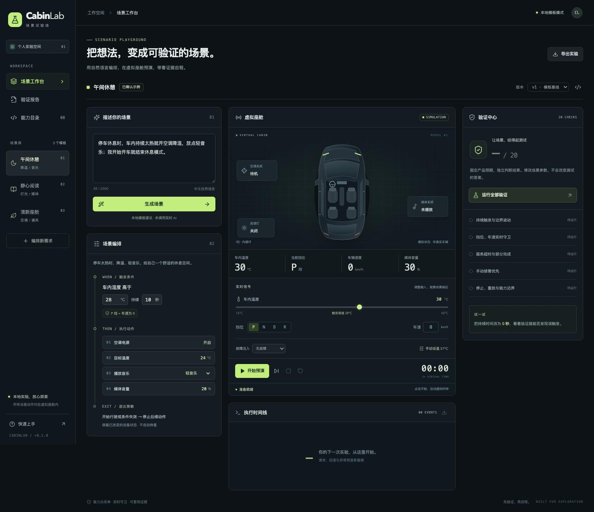

# CabinLab · 场景试验场

**把一句话变成可解释的车内自动化，在虚拟座舱里先预演、再验证。**

面向座舱产品、开发与测试人员的自然语言场景编排工作台。首版提供完整的本地演示、可配置的服务端模型编译接口、确定性执行器和独立验证器。

> 当前为独立通用原型。所有车辆信号、能力和执行反馈都是模拟数据，不连接真实车辆，不使用雇主代码、内部接口或真实用户日志。



## 立即运行

需要 Node.js **22.13+**，推荐 Node.js 22 LTS。

```bash
npm ci
npm run dev
```

打开 **http://127.0.0.1:5173**。默认只监听本机，不需要任何密钥，不发起模型调用。请使用 Node 服务启动；单独运行 Vite 不提供编译 API。

生产构建也可在本机运行：

```bash
npm run build
npm start
```

修改端口：`PORT=5174 npm run dev`。首次启动没有 `.env` 的提示是正常现象。

## 三分钟实验

1. 选择「午间休憩」。默认显示的是**已确认的示例**：P 挡、车速 0、温度高于 28°C 持续 10 秒。
2. 点击「生成场景」，查看**候选草案**。核对温度、持续时间、动作和退出策略，再点「确认参数并保存版本」。
3. 点击「开始预演」。虚拟时钟以 2 倍速推进；第 10 秒触发，随后每秒回读一个动作结果。可以暂停、单步、停止。
4. 从「故障注入」选择「目标温度超时」，重新运行。空调目标温度不会成功回读，媒体仍执行，结果明确标为「部分完成」。
5. 运行全部验证：模板版本应为 **20/20**。把持续时间改为 **0 秒**、确认新版本、再验证，固定预期会发现短时波动误触发。选择旧版本，验证恢复通过。
6. 导出实验或某个用例的证据。点击重放，使用相同初始状态、故障与输入轨迹重建执行结果。

演示讲稿见 [docs/demo.md](docs/demo.md)。

## 已实现

| 模块       | 行为                                                                   |
| ---------- | ---------------------------------------------------------------------- |
| 场景库     | 午间休憩、静心阅读、清新座舱；每个模板保留最近 30 个本地版本           |
| 编译与澄清 | 生成结构化草案；显式展示停车定义、阈值、持续时间、退出、超时和接管策略 |
| 能力目录   | 8 项白名单能力；参数范围、依赖、前置条件、可观测结果                   |
| 虚拟台架   | 温度 / 照度 / CO₂、挡位、车速、空调、媒体、阅读灯状态                  |
| 执行器     | 可控时钟、连续计时重置、单次触发、实时守卫、在途取消、依赖检查         |
| 异常处理   | 逐能力超时注入；独立动作继续；用户手动操作锁定本次运行中的对应设备     |
| 验证器     | 每个场景 20 项固定产品基线验证；结果与事件证据可展开、导出             |
| 证据       | 冻结的场景版本、初始状态、故障、输入命令、请求接受、状态回读、终态     |
| 界面       | 中文工作台、桌面 / 移动布局、键盘可操作控件、DSL 查看、JSON 导出       |

模拟动作：`climate.power`、`climate.temperature`、`climate.fan`、`climate.recirculation`、`media.play`、`media.pause`、`media.volume`、`ambient.light`。

## 本地模式与真实模型

默认 `LLM_PROVIDER=demo`：**关键词选择模板，不是实时 AI**。它不理解任意自然语言，也不提取自定义数值。界面会明确提示，所有候选参数需要人工核对；可编辑阈值、持续时间、目标温度、音量、风量、亮度和曲目。

真实模型适配器使用服务端的 **Chat Completions 兼容协议**：

```bash
cp .env.example .env
```

编辑 `.env` 并重启服务：

```dotenv
LLM_PROVIDER=openai-compatible
LLM_BASE_URL=https://your-provider.example/v1
LLM_MODEL=your-model-id
LLM_API_KEY=your-server-side-key
```

服务端向 `${LLM_BASE_URL}/chat/completions` 发送 `model` 和 `messages`，通过 `Authorization: Bearer …` 鉴权，从 `choices[0].message.content` 读取一个 JSON 场景对象。接口说明参考 [OpenAI Chat Completions API](https://developers.openai.com/api/reference/resources/chat)。这是显式的兼容接口，不代表所有模型服务均受支持。

- 密钥仅存在服务端 `.env`；该文件已被 Git 忽略。不要给变量加 `VITE_` 前缀。
- 配置不完整时启动失败，不静默切回演示模式。服务故障时显示错误，不伪造成功结果。
- 模型输出必须通过白名单、严格 Schema、能力依赖校验；模型不能修改执行器或直接调用设备。
- 模型无权确认场景；其 `confirmed` 强制重置为 `false`。所有生成参数都需人工确认。
- 用户取消生成会取消服务端上游请求；请求超时为 30 秒，最多两个同时编译请求。
- **目前只用受控模拟响应测试了适配器，未使用真实模型凭证实测。** Genesis 或其他厂商是否兼容，需要依据其官方协议单独验证；项目未内置任何厂商地址假设。
- 启用真实服务后，调用可能产生该服务的费用。原型没有用户认证或多租户隔离，继续保持本机访问；公网交付需要另做认证、请求配额和部署配置。

## 执行语义


- 停车始终为 **P 挡且车速为 0**。该首版不支持行驶中自动化。
- 持续计时从条件首次满足开始；中途恢复就清零。恰好等于阈值不触发。
- 一次运行最多触发一次。条件变化、停止或完成后，需显式「开始预演」才开启新运行。运行中的重复开始只会继续当前运行。
- 每个请求前及回读前复查停车与触发条件。条件失效取消在途和后续动作。停止不会恢复已经改变的状态。
- 每个成功模拟动作在被接受的下一秒回读。超时动作不会改变模拟状态。依赖空调电源的动作只有电源已达成才允许发出。
- 手动操作后，本次运行不再控制同一设备资源。这里资源分为 `climate`、`media`、`ambient`；新运行显式重置接管锁。
- 「目标温度已达成」指**空调设定值回读**，不代表车内温度已降到该值。传感器由用户或测试输入驱动，没有热力学模型。
- 「重放」重建到所导出轨迹的当前时刻，包含手动操作、信号变化与停止；它不是物理世界的自动回滚。若原轨迹尚未结束，可以从重放时刻继续。

更详细的模块说明见 [docs/architecture.md](docs/architecture.md)。

本机实际测试结果及边界见 [docs/validation.md](docs/validation.md)。

## 验证的范围

运行验证时，预期来自 [`templates.ts`](src/domain/templates.ts) 中固定的产品基线，不来自当前被测场景或模型生成的测试答案。改变持续时间不会让测试自动改成新的预期。

20 项涵盖正常执行、持续边界、抖动、严格阈值、计时重置、挡位与车速守卫、在途条件变化、单次执行、接受与回读分离、停止、无隐式回滚、超时、依赖与独立动作、手动接管、重放、白名单、确认要求。

自定义需求可以合理地偏离模板基线，报告会将差异显示为失败。要验证全新的产品需求，应另行审阅并建立新基线。**验证通过只表示当前仿真模型和用例集合通过，不是量产安全认证，也不是完整需求覆盖证明。**

## 开发与测试

```bash
npm run check          # 类型检查、lint、自动测试、生产构建
npm run format:check   # 格式检查
npm run format         # 统一格式
```

自动测试使用 Node.js 自带测试框架，包含三个模板各 20 项验证，以及执行器、编译器和真实本机 HTTP 服务边界测试。HTTP 测试需要允许监听 loopback 临时端口。

浏览器验收使用 Python Playwright。先在一个终端运行 `npm run dev` 或 `npm start`，再在另一个终端执行：

```bash
python3 -m venv .venv
source .venv/bin/activate
pip install -r requirements-test.txt
python -m playwright install chromium
python scripts/e2e.py
```

可用 `CABINLAB_URL=http://127.0.0.1:5174` 指定测试地址。脚本创建独立浏览器上下文，不修改日常浏览器数据。检查桌面和 390px 移动布局、重复生成、确认门禁、暂停 / 单步 / 停止、重放、超时恢复、手动接管、版本回退、生成取消 / 失败、持久化。截图与 JSON 证据输出到被 Git 忽略的 `artifacts/`。

GitHub Actions 已配置相同检查，并在生产构建上运行浏览器验收。工作流需推送到确认的远程后才会实际运行。

## 目录

```text
src/domain/           场景 Schema、能力、模板、执行器、验证器
src/components/       虚拟座舱和验证面板
src/App.tsx           编排、版本和预演工作台
server/               编译 API、模型适配器、开发 / 生产入口
tests/                自动化领域与 HTTP 测试
scripts/e2e.py        浏览器验收
docs/                 架构、演示与验收记录
.github/workflows/    GitHub CI
```

本地版本写入浏览器 Local Storage；运行轨迹只在当前页面内存中，刷新会清除，重要实验请先导出。首版没有云端账户、跨设备同步、语音输入、真实车机接入和公网部署。
