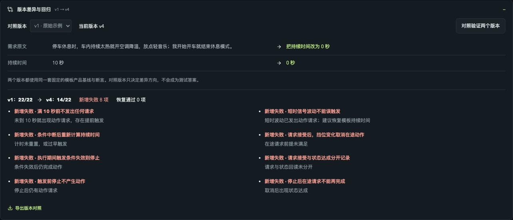
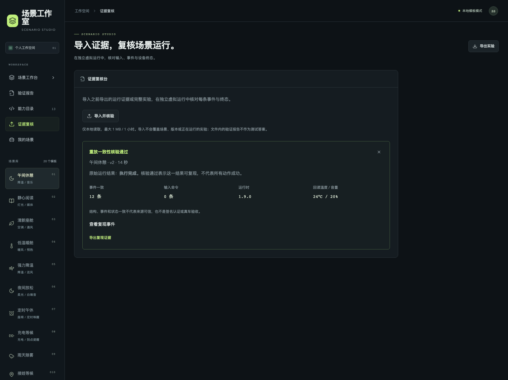

# 本地验收记录

## 2026-11-07 午休与充电退出恢复及雨天关窗提醒

- 446 项自动测试和 38 组 Chromium 验收通过。定时午休唤醒后恢复原座椅、空调和媒体设置。充电等候达标或停车拔枪后恢复原座椅和空调设置。已接管、回读未知或不满足停车与座位占用条件时，相关恢复动作跳过。
- 雨天自动关窗和雨天联动均在关窗结果出现时提示一次。成功、在途遇阻取消和回读未知可区分。联动遇阻后的除雾与后视镜加热仍成功回读。重放保持静音。
- 三个真实模型各 8 / 8 通过。每款模型覆盖午休、充电等候、雨天自动关窗和雨天联动的生成、修改、预演与重放。最终批次 24 个请求均返回 HTTP 200，无切换、超时或修复重试。
- 浏览器另用真实模型修改午休时间为 21 分钟、充电提醒为 85%，并在雨天联动里模拟在途关窗遇阻。三份运行证据均独立重放通过。1.2.0 的午休及充电证据和 1.6.0 的宠物与雨天联动证据仍按原语义重放。

## 2026-11-07 宠物持续监测与雨天联动

- 440 项自动测试和 38 组 Chromium 验收通过。持续异常只提示一次，新异常单独提示，恢复后再触发。证据重放可复核当前异常，且保持静音。上一版宠物记录仍按原运行时语义重放。
- 雨天联动按顺序回读四门车窗、空调、前挡除雾与后视镜加热。窗路受阻仍执行独立动作，空调开启失败仅阻止依赖它的前挡除雾。
- 一个真实备用模型两轮 8 / 8 通过，并在浏览器确认了两个修改版。前次公司网关返回 HTTP 503。恢复后直连 DeepSeek 和 GLM 各跑两轮，每轮覆盖宠物留舱和雨天联动的生成与修改。两款模型各 **8 / 8** 通过，每个草案均完成预演和证据重放。16 次请求均返回 HTTP 200，无备用切换、超时或修复重试。

浏览器使用两款模型各自生成并确认的 v3 修改版复测，运行时为 1.6.0。

- **宠物留舱**在虚拟第 8 秒达到 31°C，发出一次高温提示音，并继续监测。随后保持高温 12 个虚拟秒，期间未重复报警。电量降至 20% 时单独提醒。舱温回到 30°C 后再次升到 31°C，才再次提醒高温。导出记录共三条提醒，终态仍为监测中，重放无提示音。
- **雨天联动**在虚拟第 7 秒记录关窗请求已接受，模拟障碍出现后同秒取消关窗。第 8 秒空调成功回读，第 9 秒前挡除雾成功回读，第 10 秒后视镜加热成功回读。两款模型的遇阻预演均为部分完成，四门车窗未全闭，除雾和加热均已开启。无障碍对照均完成。
- 两款模型各有三份浏览器证据，分别为宠物监测、正常联动和关窗遇阻。六份文件均通过独立重放，原始文件及逐请求报告保存在本机 `.local/`。

## 2026-11-07 宠物留舱与雨天后视镜加热

- 414 项自动测试和 37 组 Chromium 验收通过。宠物留舱覆盖在舱确认、高温与低电量边界、电量未知、空调回读丢失和离舱退出。后视镜加热覆盖雨量边界、停车守卫和开关回读。
- 三个真实模型分别执行两轮生成、修改、预演和重放，各 8 / 8 通过，均无超时或修复请求。三个模型也分别在浏览器确认并预演了两套修改版，共 6 条通过。
- 在舱输入、舱温、电量和后视镜加热均为仿真。宠物监测在首个提醒后结束。

## 2026-11-07 主驾离车后的乘客等候与雨天自动关窗

- 379 项自动测试和 35 组 Chromium 验收通过。浏览器在演示模式生成、修改并预演两套场景，覆盖关门后才开始计时、后排占用、雨量阈值、在途障碍和四窗全闭回读。
- 受控模型服务返回的 4 个生成与修改样本通过场景校验、预演和重放。两个真实模型的首次请求与复测均收到 HTTP 503。网关报告共享席位配额已用尽，本轮尚无真实模型结果。

## 2026-11-07 雨天除雾与接娃等候

- 347 项自动测试和 33 组 Chromium 验收通过，覆盖雨量与距离阈值、离开范围时停止在途动作、空调开启失败时阻止除雾、前挡状态回读和证据重放。
- 两个真实模型各跑三轮生成、修改、预演和独立重放，最终各 12 / 12 通过，无超时或修复重试。首轮一次修改因动作 JSON 非法而被拒绝，补充动作结构示例后重跑通过。
- 两个模型分别在浏览器确认并预演了修改版。雨天除雾改为持续 7 秒和 4 档风量，接娃等候改为 120 米和 25°C。距离、雨量与前挡回读均为仿真。

## 2026-11-07 定时午休与充电等候

- 自动测试 **298 / 298**，类型、ESLint 和生产构建通过。演示模式 Chromium **31 / 31**，验证到点唤醒、预演提示音仅响一次、证据重放静音、空座不动、达到电量阈值提醒和拔枪取消。
- 两个真实模型分别执行三轮，每轮包含两个场景的生成与修改。最终两个模型各 **12 / 12** 通过，无超时、无修复，成功样本 p95 分别为 2.61 秒和 4.37 秒。每份实际草案均核对参数和动作顺序，并预演和独立重放。首轮较快模型曾三次调换充电准备动作，明确要求依次执行后重跑通过。
- 两个模型还分别通过一次浏览器闭环：生成、确认、修改、再次确认和预演。午休改为 21 分钟，充电提醒改为 85%，各自在设定边界触发一次，座椅回读也与修改值一致。

真实模型报告保留在本机。车辆信号、座椅执行和唤醒计时均为仿真。

## 2026-11-07 场景扩充与模型稳定性

- 场景库扩展为六类，新增低温暖舱、强力降温和夜间放松。沿用条件连续成立、停车守卫与依次执行的通用编排方式；仍使用三类合成信号和八项模拟能力。旧三类场景的自定义版本保留，缺少的新模板自动补齐。
- 自动测试 **270 / 270** 通过；类型、ESLint、格式和生产构建通过。演示模式 Chromium **29 / 29** 组通过，包含六场景、旧缓存迁移、桌面和 390px 布局。
- 两轮完整真实模型批次覆盖六类场景的生成和修改，共 48 个有效用例：较快模型 24 / 24，成功样本 p95 为 2.27 秒；另一模型 23 / 24，成功样本 p95 为 3.81 秒。该批次没有超时。唯一失败是夜间场景在已提供条件时仍返回澄清；明确默认动作超时后，定向生成和修改复测 3 / 3 通过。
- 在浏览器中验证新增暖舱场景的真实生成、确认、修改、再确认和预演。另用已观测的非法 JSON 作为首轮故障样本，实际调用模型完成一次修复并通过完整校验；该测试区分注入响应与真实修复请求。

修改稳定性的实际问题包括说明文字被顺带改写、条件持续时间被写成动作超时，以及模型输出非法 JSON。现在使用行为参数增量补丁，明确 `trigger.holdSeconds` 与 `timeoutSeconds` 的含义；不可修改的字段由服务端保留。完整输出校验失败可在原截止时间内定向修复一次，修复状态在界面可见；不自动重试鉴权、限流、网络、截断和取消。

慢请求探测显示，事件流可在约 1 秒返回响应头，但较重推理仍可能迟迟没有文本；显式低推理强度、提示词强度提示和精简补丁共同改善了实际耗时。SSE 必须收到完整终态，部分文本与推理块不会成为候选。此前有独立批次收到网关快速返回的 503；不把这些响应计入模型准确率或成功延迟。验收脚本已改为顺序发送，遇到 503、限流或鉴权失败停止批次。

真实模型逐次证据保留在本机忽略目录。此样本不能保证网关持续可用；没有上传公司地址、密钥、模型标识或原始响应，也没有进行真车验证。

## 2026-11-07 原生模型接入

服务端新增 Anthropic Messages 协议，与 Chat Completions 共用场景编译、确认门禁、Schema 校验、响应大小限制和取消逻辑。公司服务地址、密钥、实际模型标识、原始响应和联调记录均只保留在本机忽略目录或配置文件，不写入仓库。

本轮已验证：

- `npm run check`：180 / 180 自动测试通过，类型、ESLint 与生产构建通过。
- 演示模式 Chromium 浏览器回归：27 / 27 组通过，涵盖桌面和 390px 移动布局。
- 两个真实文本模型均覆盖生成、修改、明确缺参澄清、不支持能力、阅读模板、清新模板、否定动作要求和越界值，共 16 个代表用例；验收不代表任意自然语言均能稳定通过。
- 较慢模型曾完成修改，但重复运行仍出现 120 秒超时；单次通过不代表延迟稳定。默认使用已完成浏览器闭环且本轮延迟较低的模型，超时会明确报错，不自动换模型或重试。
- 真实模型浏览器操作覆盖生成草案、人工确认保存、修改差异、再次确认和虚拟预演；修改后的空调设定值与运行证据一致，无未捕获页面异常。

真实联调曾发现较慢模型超过默认 30 秒，以及推理块耗尽原 4096 token 上限而没有场景 JSON。原生输出上限调整至 16384，超时可配置为 1–120 秒，本机使用 120 秒；截断仍明确拒绝，不把空结果或不完整 JSON 当作成功。未采用服务不支持的推理关闭参数。模型提示词补充各信号的实际范围，避免将通用 Schema 数值边界错误用于某一传感器。

新增合约覆盖请求头与路径、顶层 system、多段文本、推理块隔离、截断、工具调用、非法参数、错误响应、取消与超时配置。ESLint 忽略 `.local`，不扫描本机联调脚本。纯模拟回归和真实模型验收分别运行，CI 不调用真实模型。

本轮没有真实车机或车辆接入。两条上游 Zod Rollup 注释提示与 Node.js 26 的 loader 弃用提示仍存在，未影响通过结果。

## 2026-11-07 本轮优化

环境：macOS、Node.js 26.13.0、Python 3.14.8、Playwright 1.58.0。本机生产构建运行于 loopback，显式设为演示模式；未加载真实模型凭证。

| 检查                   | 本轮结果                                                               |
| ---------------------- | ---------------------------------------------------------------------- |
| 改动前基线             | 135 / 135 自动测试通过                                                 |
| 类型、ESLint、生产构建 | `npm run check` 通过                                                   |
| 改动后自动测试         | 164 / 164 通过，0 跳过                                                 |
| 格式                   | `npm run format:check` 通过                                            |
| 模板产品基线           | 每个模板 22 / 22；零秒修改 14 / 22，仍发现 8 项回归                    |
| 浏览器                 | Chromium 27 / 27 组通过；1536×1150 与 390×844 无横向溢出，无未捕获异常 |
| 依赖安装审计           | `npm ci --ignore-scripts` 报告 0 项已知漏洞，依本轮公告库              |

新增验收覆盖：请求拒绝不得记为接受或达成；回读丢失保持未知、停止同设备后续控制、继续独立设备；在途停止不再产生迟到模拟达成；未知结果不能篡改为成功、普通失败或超时；新会话独立重放；原提交运行时生成的 1.0.0 固定证据仍可复核；否定、取消和自定义中文数值先澄清，三个完整示例仍可创建待确认草案。

浏览器发现并修正了旧界面写死的验证总数：版本对照、验证标题与成功提示均从实际报告读取。截图与 JSON 留在本机 `artifacts/`：`browser-verification.json`、`run-rejected.json`、`run-feedback-lost.json`、`run-feedback-lost-replay.json`、`feedback-lost.png` 及既有流程产物。README 工作台、版本对照和证据复核截图已更新。桌面及移动证据复核截图经过人工目视检查。

运行时新标识为 1.1.0，验证契约为 1.1，场景 Schema 与本地版本存储格式不变。项目软件版本仍为 0.2.0，未创建新标签或 release。ESLint / Prettier 现在忽略 README 推荐的 `.venv`，避免扫描 Playwright 的第三方 JavaScript。

两条 Zod 上游注释位置的 Rollup 提示仍存在，未影响构建。Node.js 26 的 tsx loader 有弃用提示；本地未在 CI 所用 Node.js 22 重跑。未执行 Android Gradle、真实模型、设备或车辆验证，也未进行公网部署。未知结果的状态图是最后已知值；一致性复核不证明车辆实际效果或证据来源。远端 CI 状态按对应提交的 Actions 记录判断。

工程证据与映射见 [本地优化记录](local-optimization.md)。

## 2026-11-02 历史 v0.2 验收

以下是原交付快照，与上方本轮结果分别记录。

验收日期：2026-11-02。环境：macOS、Node.js 22.22.2、Python 3.12.10、Python Playwright 1.58.0 / Chromium。使用本地生产构建、演示模式；模型测试使用受控 mock，没有真实模型调用。

| 检查                | 实际结果                                          |
| ------------------- | ------------------------------------------------- |
| TypeScript 类型检查 | 通过                                              |
| ESLint              | 通过，0 warning                                   |
| Node.js 自动测试    | **135 / 135 通过**，0 跳过                        |
| 生产构建            | 通过；主脚本 gzip 约 111 KB                       |
| 浏览器验收          | **23 / 23 组通过**                                |
| 桌面 / 移动布局     | 1536×1150、390×844，无横向溢出                    |
| 浏览器运行错误      | 没有未捕获 JavaScript 异常                        |
| npm audit           | **0 项已知漏洞**（依验收时公告数据库）            |
| 敏感内容检查        | 未发现真实 `.env`、凭证、私钥、雇主地址或内部代码 |

生产构建有两条来自 Zod 上游 `@__PURE__` 注释位置的 Rollup 提示；只删除了无法解释的注释，构建和执行均通过。

## 关键证据

- 三个固定模板分别通过 20 项独立产品基线验证。
- 午间休憩持续时间改成 0 秒后为 **12 / 20**：时间边界、短时抖动、计时重置等偏离固定产品预期。选择旧版本后恢复 20 / 20。
- 温控超时：目标温度保持原值、媒体继续、运行明确报告部分完成。
- 用户手动设温：正在等待回读的温控请求取消，最终保持 27°C。
- 行驶状态：请求已接受但尚未回读时切换 D 挡，取消在途和后续动作。
- 重放：原始轨迹和重放轨迹的事件及设备终态相等，包括手动操作与停止。
- 生成重复点击只有一个请求；取消后晚到响应不会覆盖场景；失败不会伪造候选场景。
- 真实 HTTP 接口测试覆盖同源、Host 校验、请求体限制、并发限制、取消传递、上游错误与响应大小限制。
- 修改上下文：请求携带当前已确认场景；多参数草案先展示差异，放弃后基准不变。混合未支持动作、模糊数值、重复参数和越界值整次拒绝。
- 版本对照：同一断言集发现 **8 项新增失败**；反向比较显示 **8 项恢复通过**。两版结果及证据可一起导出。
- 跨会话导入：新浏览器上下文独立重放先前文件，事件与终态一致，当前版本和暂停中的运行保持原样。部分完成与停止记录明确保留原结果。
- 导入边界：篡改终态、事件、状态、时间、命令、进度或锁会被发现；未知能力、倒序记录、旧运行时、损坏 JSON、超限大小或数量被拒绝。失败后可重新导入。
- 长等待重放：630 秒后才满足条件的记录可按分段时钟重放至第 644 秒的终态。
- mock provider：鉴权失败、限流、错误响应、模型澄清、修改基准、响应头前后超时、流读取取消、最长中文请求均有合约测试。一次请求不会自动重试。
- 浏览器竞态：编辑输入或切换场景取消旧请求，晚到结果不会覆盖当前内容；同一批双击单步连续推进两秒，不重建运行。

## 本地证据文件

运行 `python scripts/e2e.py` 会重新生成以下文件；它们保留在本机 `artifacts/`，没有提交到 Git：

- `browser-verification.json`：23 项浏览器检查清单。
- `run-success.json`、`run-replay.json`：正常执行与重放对照。
- `run-timeout.json`、`run-manual.json`、`run-motion.json`：超时、接管、挡位变化证据。
- `run-cancelled.json`、`run-cancelled-replay.json`：停止与重放对照。
- `verification-regression.json`：零秒变更的逐用例报告。
- `version-comparison.json`、`version-comparison.png`：两版对照报告及截图。
- `experiment.json`、`import-replayed.json`：完整实验导入与独立复现证据。
- `run-tampered.json`、`run-legacy.json`：只用于拒绝路径验收的负向样本，不是有效证据。
- `evidence-inspector.png`、`evidence-mobile.png`：桌面及移动端证据复核截图。
- `workbench-initial.png`、`workbench-completed.png`、`workbench-mobile.png`：浏览器截图。

## 尚未运行或交付

真实模型连接只验证了请求契约和受控模拟响应，未使用真实服务端密钥实测。Safari / Firefox、真实车辆、跨运行时版本重放未验证。一致性核验不证明文件来源，也无法识别同时修改输入与结果而仍保持一致的记录。

私有仓库为 [yorkvolvo/CabinLab](https://github.com/yorkvolvo/CabinLab)。GitHub Actions 在 Ubuntu 24.04 上运行格式、类型、lint、全部自动测试、生产构建及同一浏览器脚本；各提交的实际状态与浏览器证据见 [GitHub Actions](https://github.com/yorkvolvo/CabinLab/actions)。本轮软件版本为 0.2.0，既有 `v0.1.0` Git 标签保持不变。尚未部署网站或提交比赛材料。
