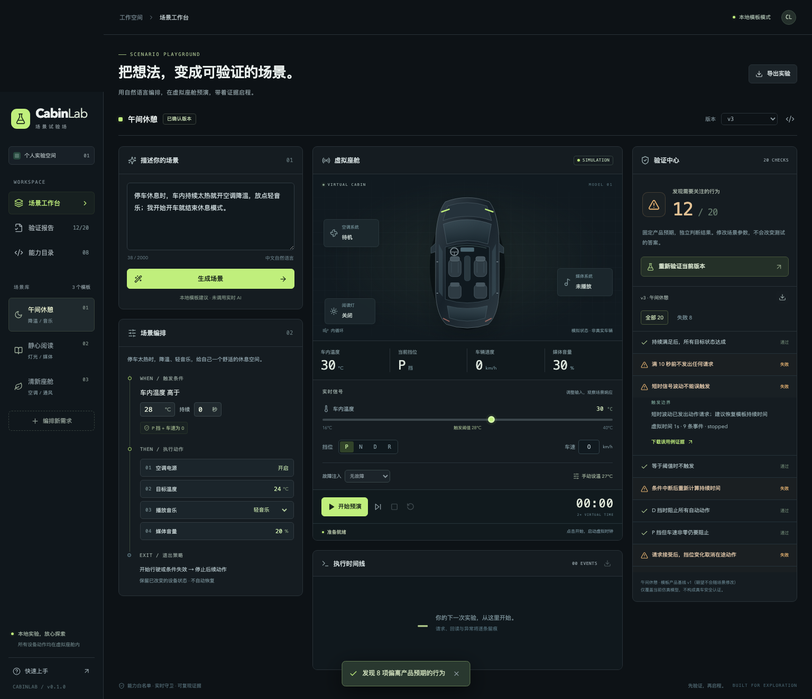

# 初版验收记录

验收日期：2026-11-01。环境：macOS、Node.js 22.22.2、Python 3.12、Python Playwright 1.58.0 / Chromium。使用本地生产构建、演示模式，没有真实模型调用。

| 检查                | 实际结果                                          |
| ------------------- | ------------------------------------------------- |
| TypeScript 类型检查 | 通过                                              |
| ESLint              | 通过，0 warning                                   |
| Node.js 自动测试    | **89 / 89 通过**，0 跳过                          |
| 生产构建            | 通过；主脚本 gzip 约 106 KB                       |
| 浏览器验收          | **16 / 16 组通过**                                |
| 桌面 / 移动布局     | 1536×1150、390×844，无横向溢出                    |
| 浏览器运行错误      | 没有未捕获 JavaScript 异常                        |
| npm audit           | **0 项已知漏洞**（依验收时公告数据库）            |
| 敏感内容检查        | 未发现真实 `.env`、凭证、私钥、雇主地址或内部代码 |

生产构建有两条来自 Zod 上游 `@__PURE__` 注释位置的 Rollup 提示；只删除了无法解释的注释，构建和执行均通过。

## 关键证据

- 三个固定模板分别通过 20 项独立产品基线验证。
- 午间休憩持续时间改成 0 秒后为 **12 / 20**：时间边界、短时抖动、计时重置等偏离固定产品预期。选择旧版本后恢复 20 / 20。
- 温控超时：目标温度保持原值、媒体继续、运行明确报告部分完成。
- 用户手动设温：正在等待回读的温控请求取消，最终保持 27°C。
- 行驶状态：请求已接受但尚未回读时切换 D 挡，取消在途和后续动作。
- 重放：原始轨迹和重放轨迹的事件及设备终态相等，包括手动操作与停止。
- 生成重复点击只有一个请求；取消后晚到响应不会覆盖场景；失败不会伪造候选场景。
- 真实 HTTP 接口测试覆盖同源、Host 校验、请求体限制、并发限制、取消传递、上游错误与响应大小限制。

## 本地证据文件

运行 `python scripts/e2e.py` 会重新生成以下文件；它们保留在本机 `artifacts/`，没有提交到 Git：

- `browser-verification.json`：16 项浏览器检查清单。
- `run-success.json`、`run-replay.json`：正常执行与重放对照。
- `run-timeout.json`、`run-manual.json`、`run-motion.json`：超时、接管、挡位变化证据。
- `run-cancelled.json`、`run-cancelled-replay.json`：停止与重放对照。
- `verification-regression.json`：零秒变更的逐用例报告。
- `workbench-initial.png`、`workbench-completed.png`、`workbench-mobile.png`：浏览器截图。

## 尚未运行或交付

真实模型连接只验证了请求契约和受控模拟响应，未使用真实服务端密钥实测。Safari / Firefox、真实车辆、跨运行时版本重放未验证。

GitHub Actions 工作流已准备，但截至本记录，未配置 Git 远程，尚未推送，因此远程 CI **未运行**。目标仓库 owner/repo 与可见性待确认；没有擅自创建远程仓库、发布网站或提交比赛材料。
